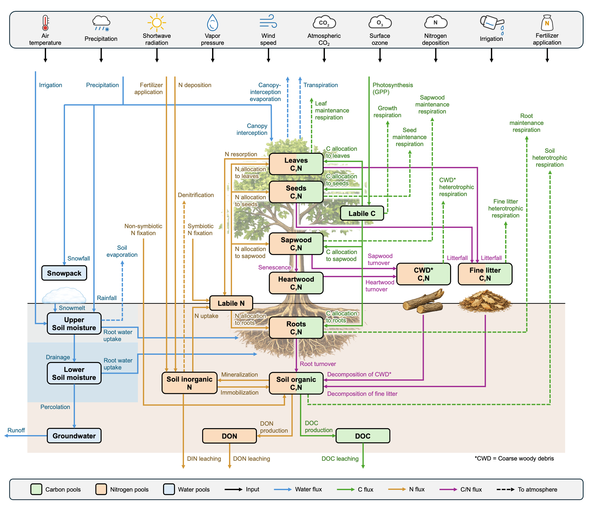
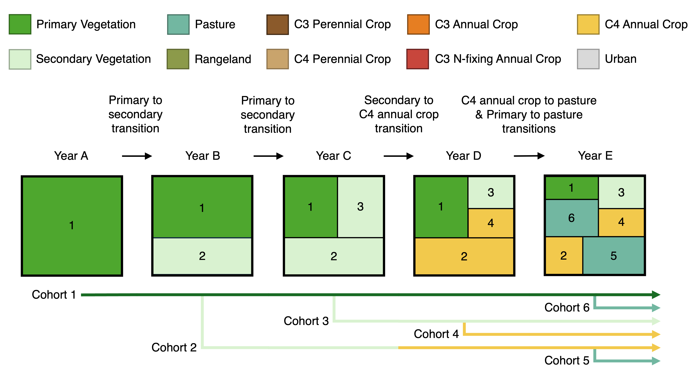
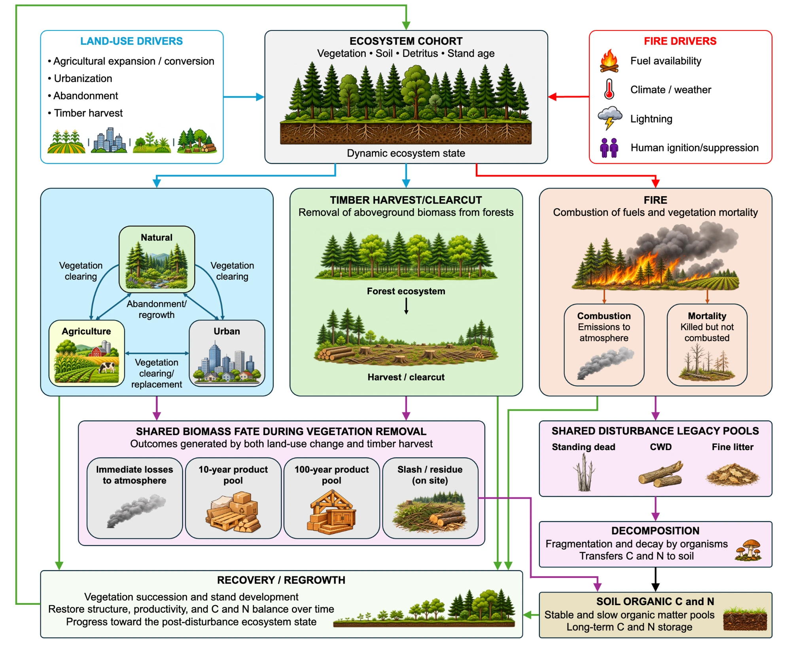

# Model Description and Structure

GDSTEM is a process-based terrestrial ecosystem model that simulates coupled **carbon, nitrogen, and water dynamics** within natural and managed terrestrial ecosystems. The model represents vegetation structure, land-use and land-management dynamics, disturbance, and ecosystem responses to environmental drivers including climate, atmospheric CO₂, nitrogen deposition, and tropospheric ozone.

*Figure 1. Schematic of GDSTEM showing the major ecosystem pools, fluxes, processes, and environmental inputs of an undisturbed stand. Disturbances are shown in Figure 3.*

---

## Carbon, nitrogen, and water cycling

### Carbon cycle

GDSTEM represents the uptake, allocation, storage, and loss of carbon through vegetation, dead organic matter, and soils.

Vegetation carbon is distributed among structural and storage pools:

- Leaves
- Seeds
- Sapwood
- Heartwood
- Fine roots
- Labile carbon

Dead organic matter is held in **coarse woody debris** (from sapwood and heartwood turnover) and **fine litter** (from leaf and seed litterfall), which decompose into **soil organic matter**. Disturbances add a **standing dead** wood pool (see [Disturbances](#disturbances)).

Major carbon fluxes include gross primary productivity (GPP), maintenance and growth respiration, net primary productivity (NPP), vegetation turnover, litterfall, decomposition of dead wood, litter, and soil organic matter, heterotrophic respiration, dissolved organic carbon losses, and carbon fluxes associated with disturbance, land-use change, and management.

The model tracks changes in vegetation, dead organic matter, and soil carbon stocks through time in response to environmental conditions, ecosystem development, and disturbance.

### Nitrogen cycle

GDSTEM represents an **open nitrogen cycle** based on developments introduced in TEM6.0. Nitrogen can enter, cycle through, and leave terrestrial ecosystems through multiple pathways.

Processes represented include:

- Atmospheric nitrogen deposition
- Symbiotic and non-symbiotic biological nitrogen fixation
- Nitrogen fertilization
- Nitrogen uptake by vegetation
- Nitrogen resorption from senescing leaves
- Mineralization and immobilization
- Dissolved inorganic nitrogen leaching
- Dissolved organic nitrogen losses
- Denitrification

Nitrogen availability interacts with vegetation productivity and carbon cycling, allowing nutrient limitation to influence ecosystem responses to environmental change.

### Water cycle

GDSTEM represents the major terrestrial hydrological processes controlling water availability to vegetation and the transfer of water through ecosystems.

Precipitation falls as rain or snow, part of it is intercepted by the canopy, and snow accumulates in a snowpack until it melts. Soil water in the rooting zone is represented in **two layers**: rain, snowmelt, and irrigation enter the upper layer, which also supplies soil evaporation; roots take up water from both layers; water drains from the upper to the lower layer and percolates from the lower layer to groundwater, which feeds runoff.

Evapotranspiration is computed separately for the soil and the canopy (Shuttleworth–Wallace). Water availability influences vegetation productivity and biogeochemical cycling, providing a coupled representation of carbon, nitrogen, and water dynamics.

---

## How a stand works

Within each ecosystem cohort, GDSTEM links plant physiology, carbon and nitrogen allocation, and decomposition:

- **Photosynthesis** is set jointly by light, atmospheric CO₂, water, nitrogen, and ozone. Stomatal conductance follows the Medlyn optimal-conductance model, and ozone reduces both photosynthesis and nitrogen uptake.
- **Water stress** depends on both soil water and the plant's hydraulic conductance through its stems and roots, so plant structure shapes drought response.
- **Allocation** of new carbon and nitrogen among leaves, sapwood, and roots compares the marginal benefit and cost of each tissue, so growth goes where it pays most. Heartwood forms from sapwood, and seeds receive a share of new growth.
- **Labile reserves** of carbon and nitrogen buffer the plant through months when respiration and growth exceed uptake.
- **Turnover** of leaves, seeds, wood, and roots supplies fine litter, coarse woody debris, and soil organic matter, which **decompose** at rates that depend on temperature and soil moisture.
- **Nitrogen** cycles through an open nitrogen cycle with inputs, internal recycling, and losses.

---

## What sets GDSTEM apart

Compared with common practice among dynamic global vegetation models, GDSTEM combines several distinctive features:

| | Common practice | GDSTEM |
|---|---|---|
| **Time step** | Half-hourly or daily | Monthly forcing with daily integration |
| **Allocation** | Fixed fractions or allometry | Marginal benefit versus cost |
| **Water stress** | Soil-moisture factor | Soil water and plant hydraulic conductance |
| **Ozone** | Rarely represented | Reduces photosynthesis and nitrogen uptake |
| **Land use** | Plant functional type tiles with little history | Cohorts with age and land-use history |
| **Managed land** | Crops and pasture | C3 annual, C3 nitrogen-fixing annual, C4 annual, C3 perennial, and C4 perennial crops; pasture; rangeland; urban land with vegetation and turf |

Individual models share some of these features, but few combine them. GDSTEM reads monthly climate but integrates with adaptive steps of at most one day and treats day and night separately for photosynthesis and evapotranspiration, which keeps simulations fast.

---

## Vegetation representation

GDSTEM represents major differences in vegetation physiology, structure, and ecosystem functioning using **community types**, which play the role of plant functional types (PFTs). Each community type has its own parameter set controlling processes including photosynthesis, respiration, carbon allocation, vegetation turnover, nitrogen cycling, and water use.

| Forests | Tundra, grassland, and shrubland | Managed and urban |
|---|---|---|
| Boreal forest | Alpine tundra and polar desert | C3 annual crop (wheat) |
| Temperate coniferous forest | Wet tundra | C3 nitrogen-fixing annual crop (soybean) |
| Temperate deciduous forest | Short grassland | C4 annual crop (maize) |
| Temperate broadleaved evergreen forest | Tall grassland | C3 perennial crop (fruit and nut trees) |
| Tropical evergreen forest | Mediterranean shrubland | C4 perennial crop (switchgrass) |
| Tropical deciduous forest | Xeric shrubland | Pasture |
| | Xeric woodland | Rangeland |
| | | Urban turf lawn |
| | | Impervious surface |

The land-cover map distinguishes more vegetation classes than community types; many classes, such as boreal woodlands, savannas, wetlands, floodplains, and mangroves, are represented as mosaics of community types with fixed fractions.

Vegetation carbon is explicitly separated among structural components, allowing changes in vegetation allocation and structure to be represented through time.

---

## Land use, cohorts, and ecosystem history

Land-use and land-cover change is represented using a **cohort-based framework**.

Land-use transitions create or modify vegetation cohorts that retain information about ecosystem type, age, and land-use history. Multiple cohorts with different ages and histories can therefore coexist within the same grid cell.

*Figure 2. Example of how GDSTEM represents historical land-use change using vegetation cohorts.*

This framework allows GDSTEM to represent the ecological consequences of historical land-use transitions and disturbance through their effects on vegetation structure, carbon and nitrogen stocks, and ecosystem fluxes.

The current model represents transitions among:

- Primary vegetation
- Secondary vegetation
- C3 annual crop
- C3 nitrogen-fixing annual crop
- C4 annual crop
- C3 perennial crop
- C4 perennial crop
- Pasture
- Rangeland
- Urban land

Crops are further divided into irrigated and rainfed cohorts. Timber harvest can also create secondary vegetation cohorts and alter ecosystem carbon stocks and fluxes.

---

## Disturbances

Disturbances act on each ecosystem cohort, which carries its vegetation, soil, detritus, and stand age.

*Figure 3. Disturbances in GDSTEM: land-use change, timber harvest, and fire, the fate of the removed or killed biomass, and recovery of the stand.*

- **Land-use change** moves area among natural, agricultural, and urban states, driven by agricultural expansion and conversion, urbanization, and abandonment.
- **Timber harvest and clearcut** remove aboveground biomass from forests.
- Both send the removed biomass to the atmosphere immediately, to **10-year and 100-year product pools** that decay over time, or to **slash** left on site, which enters soil organic matter.
- **Fire** combusts fuels, emitting carbon and nitrogen to the atmosphere, and kills vegetation that it does not combust. Fire is driven by fuel availability, climate and weather, lightning, and human ignition and suppression.
- Killed vegetation enters the **disturbance legacy pools** (standing dead, coarse woody debris, and fine litter), which decompose and transfer carbon and nitrogen to soil organic matter.
- After a disturbance, the stand **recovers**: vegetation regrows and its structure, productivity, and carbon and nitrogen balance develop toward the post-disturbance ecosystem state.

The **fire module is under development** and is not yet part of the current model version.

---

## Land management

GDSTEM represents several forms of land management that modify ecosystem carbon, nitrogen, and water dynamics.

Management processes include:

- **Crop calendars:** annual crops are sown, grow, and are harvested following a gridded crop calendar (GGCMI phase 3), with sowing date and time to maturity varying by location. Winter crops remain dormant during cold months, and wheat is grown as winter or spring wheat depending on the location.
- **Irrigation:** irrigated and rainfed crops are separate cohorts. Irrigated crops receive water to meet the soil-water deficit, net of rain and snowmelt, during their growing season.
- **Nitrogen fertilization** of crops, pasture, and turf lawn
- **Crop harvest**
- **Grazing**, which removes a fraction of plant production
- **Turf mowing**

**Pasture** and **rangeland** are represented as distinct managed grassland systems. Pasture represents more intensively managed grassland that can receive irrigation and fertilization and is grazed more intensively, whereas rangeland is represented without these management inputs.

Each crop category is represented by one crop: wheat for C3 annual crops, soybean for C3 nitrogen-fixing annual crops, maize for C4 annual crops, fruit and nut trees for C3 perennial crops, and switchgrass for C4 perennial crops.

Urban land is represented as a mixture of vegetated and non-vegetated components, including native vegetation, turf lawn, and impervious surfaces.

---

## Environmental drivers

GDSTEM represents ecosystem responses to interacting environmental and anthropogenic drivers, including:

- Climate variability and change
- Atmospheric CO₂
- Nitrogen deposition
- Tropospheric ozone
- Land-use and land-cover change
- Irrigation
- Fertilization

These drivers influence ecosystem productivity, vegetation structure, nutrient cycling, hydrology, and terrestrial carbon storage.

---

## Spatial and temporal configuration

For global applications, GDSTEM normally operates at:

- **0.5° latitude/longitude spatial resolution**
- **Monthly forcing**, integrated with adaptive time steps of at most one day

Historical global simulations represent changes in environmental conditions and land use beginning in **1700**.

The underlying model can also be applied at finer spatial and temporal resolutions for regional and site-level applications.

---

## Model inputs and outputs

### Major inputs

GDSTEM uses spatially and temporally varying information describing environmental conditions and human activities. Major inputs include:

- Climate
- Atmospheric CO₂
- Nitrogen deposition
- Tropospheric ozone
- Soil properties
- Vegetation and community-type distributions
- Land-use transitions
- Crop calendars
- Irrigation
- Nitrogen fertilization
- Ecosystem-specific model parameters

### Major outputs

GDSTEM produces a broad range of ecosystem state variables and fluxes.

Major carbon-cycle outputs include:

- Gross Primary Productivity (GPP)
- Net Primary Productivity (NPP)
- Autotrophic respiration
- Heterotrophic respiration
- Net ecosystem carbon exchange
- Net Biome Productivity (NBP)
- Vegetation carbon
- Dead wood and litter carbon
- Soil carbon
- Crop harvest and product pools

Nitrogen-cycle outputs include vegetation and soil nitrogen stocks and fluxes associated with nitrogen uptake, fixation, mineralization, leaching, and denitrification.

Hydrological outputs include evapotranspiration and its components, soil moisture, drainage, and runoff.

The model also produces information describing vegetation structure, ecosystem cohorts, and land-use history.

---

## Net Biome Productivity

GDSTEM uses **Net Biome Productivity (NBP)** to represent the net terrestrial carbon balance after accounting for both ecosystem metabolism and additional carbon fluxes associated with disturbance, land-use change, product pools, dissolved organic carbon losses, and crop establishment.

NBP therefore provides a more complete measure of net ecosystem carbon exchange than the difference between NPP and heterotrophic respiration alone.

---

## Current model status

GDSTEM is under active **development, calibration, and evaluation**.

Current work includes calibration and benchmarking of the community types, continued improvement of ecosystem processes, and development of additional disturbance capabilities. A **wildfire module is under development**; wetlands and permafrost are planned.

A comprehensive GDSTEM model description and evaluation manuscript is currently in preparation.

---

## Model code

The current GDSTEM source code is under active development. A public release of the current model version is planned as ongoing development, calibration, and evaluation progress.

---

## Documentation

Comprehensive model documentation is being developed alongside the GDSTEM description and evaluation manuscript and will be made available on this website.
